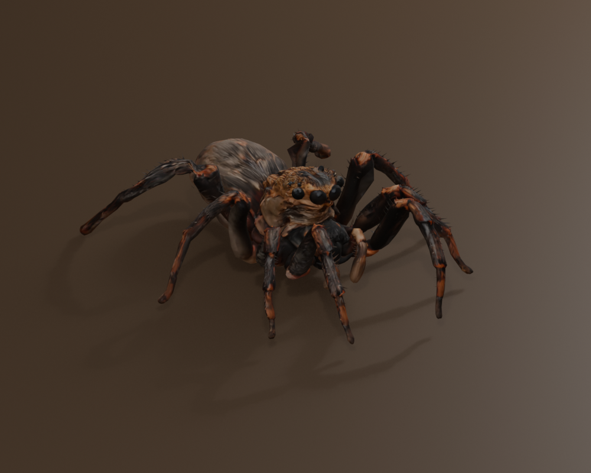

# 虫潮猎手 · Swarm Hunter


PICO Spatial MR 虫群猎杀游戏。记录自己的静态手势，靠近悬浮护腕装备，在真实空间中消灭从地面、墙面和已扫描天花板裂口出现的蜘蛛与昆虫。

- **当前体验版**：1.3.2 debug（versionCode 20）
- **包名**：`com.example.swarmhunter`
- **安装包**：[v1.3.2 Releases](https://github.com/DDDCC5/swarm-hunter/releases/tag/v1.3.2)
- **版本说明**：[1.3.2](docs/RELEASE_NOTES_1.3.2.md)
- **验证与限制**：[VERIFICATION.md](docs/VERIFICATION.md)

## 玩法

1. 在安全空间内确认提示，放下手柄，全程使用双手手势。
2. 双手保持相同的自定义静态手势约2.5秒，分别记录左右手。
3. 选择蛛丝、激光、能量弹或脉冲，双手靠近对应悬浮道具即可装备，无需先做发射手势；可返回重新注册。
4. 可选无伤练习、三种难度，以及最多两个脉冲机关。机关通过视野中心选择真实平面，任一手拇指食指捏合确认；墙面竖贴，地面/桌面平放。
5. 当前手型匹配注册手势时持续发射；手型不匹配或追踪丢失就停止新增射击。每手独立冷却，蛛丝0.20秒、激光0.15秒、能量弹0.32秒、脉冲0.55秒。
6. 昆虫可见出洞动作与其专属声音由同一事件触发，不再等待转头显形。敌群由疏到密；命中、击杀和机关触发有反馈。
7. 三条生命耗尽后结算击杀、累计存活时长、命中率及评级，可再次挑战。

面板跟随用户前方并保持竖直；护腕跟随与手指识别分离，没有常驻辅助瞄准线。中文系统只显示中文界面和语音，其他系统使用英文。音量跟随系统。

## 1.3.2 更新

- 八种虫类全部采用Tripo来源的本地绑定模型，四款简洁护腕按功能区分配色，并使用各自实际炮口坐标。
- 修复注册结束后手型难以发射；保持匹配手型连发，失配即停，并落实四武器独立发射节奏。
- 机关改为视野中心注视平面、任一手捏合放置；有限边界、面板遮挡、释放门控及撤销保护。
- 出场音画统一触发；虫体线性尺寸缩小约44%，巢穴随体型缩小，支持地/墙/顶随机出怪和渐进密度。
- 完整播放1秒翻倒收腿，再消散淡出至1.7秒清理；墙顶尸体下落。各虫种使用独立出场录音与不同节奏。
- 优化贴面运动、墙地/顶墙连续转角和步幅匹配；保留能量弹墙面反弹、表面弹着和脉冲机关。

以下是当前运行素材的离线渲染预览，**不是实机战斗截图**：




## 构建

技术栈：Kotlin 2.1.20、Compose、PICO Spatial SDK BOM 6.2.8、Gradle Wrapper 8.13。需要JDK17或更新版本、Android SDK Platform35及对应构建工具；运行目标为兼容Spatial SDK6.2的PICO头显，arm64-v8a、Android API35及以上。

官方环境指南：[PICO CLI 安装与初始化](https://lf3-static.bytednsdoc.com/obj/eden-cn/bvonuhmlkbps/other/pico-cli-installation-guide.md)。配置后执行：

```sh
./gradlew testDebugUnitTest assembleDebug
```

APK位于 `app/build/outputs/apk/debug/app-debug.apk`。配置自己的 `ANDROID_HOME` 或本地 `local.properties`。运行所需素材已包含在项目中，构建不需要Tripo授权或素材服务调用；不要提交签名密钥、凭证或本机SDK路径。

```sh
pico-cli device list --format json
pico-cli app install app/build/outputs/apk/debug/app-debug.apk --replace --device <device-id>
pico-cli app launch com.example.swarmhunter --device <device-id>
```

## 代码位置

| 路径 | 用途 |
| --- | --- |
| `app/src/main/java/com/example/swarmhunter/game/HuntRuntime.kt` | 追踪、场景、工具、音效与战斗集成 |
| `app/src/main/java/com/example/swarmhunter/game/HuntEngine.kt` | 游戏状态与手势记忆 |
| `app/src/main/java/com/example/swarmhunter/game/EncounterPresentation.kt` | 出场、尺寸、音频节奏及死亡阶段 |
| `app/src/main/java/com/example/swarmhunter/game/GazePlacement.kt` | 视野中心机关选择与平面朝向 |
| `app/src/main/java/com/example/swarmhunter/game/HandAttachmentTracker.kt` | 稳定护腕跟随 |
| `app/src/main/java/com/example/swarmhunter/content/HomeStage.kt` | 自定义Compose界面 |
| `app/src/main/assets` | 运行模型、UI与音频 |
| `app/src/test` | 逻辑回归测试 |

## 当前状态

108项单元测试、debug构建及原生启动检查通过。当前是**开发体验版**：实际门户可见性、复杂房间贴面/转角、手势与机关手感、音画同步和声音辨识、端到端发射延迟、声源定位精度及持续性能仍需实机专项验收。

依赖和素材说明见 [THIRD_PARTY_NOTICES.md](docs/THIRD_PARTY_NOTICES.md)。公开源码尚未指定项目整体开源许可证。
